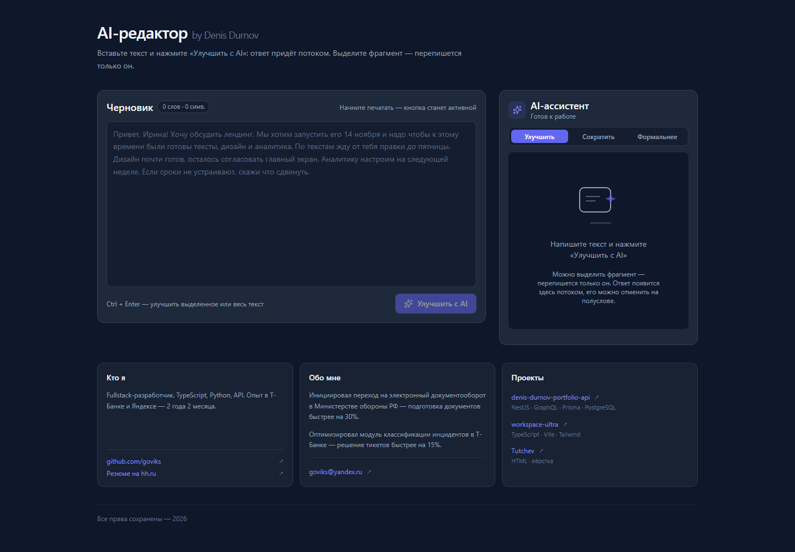
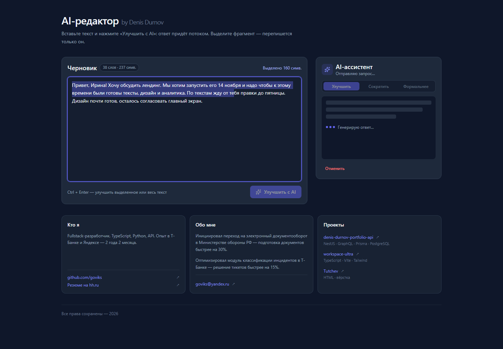
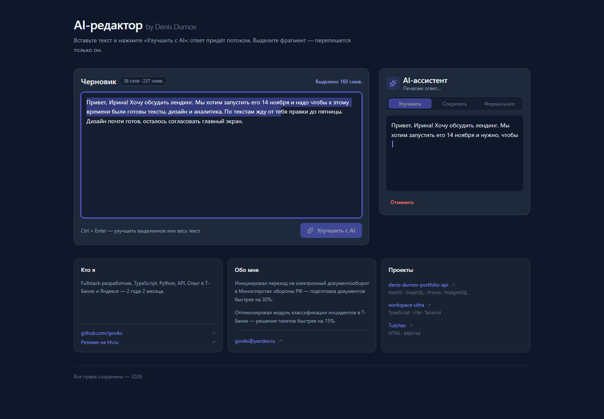
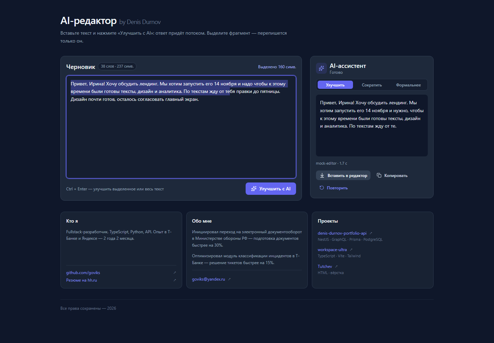
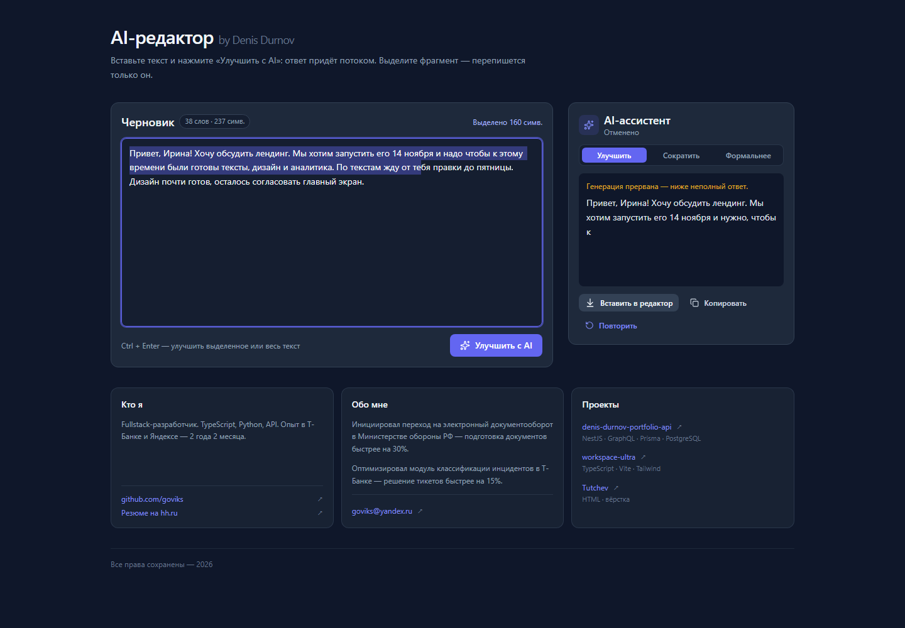
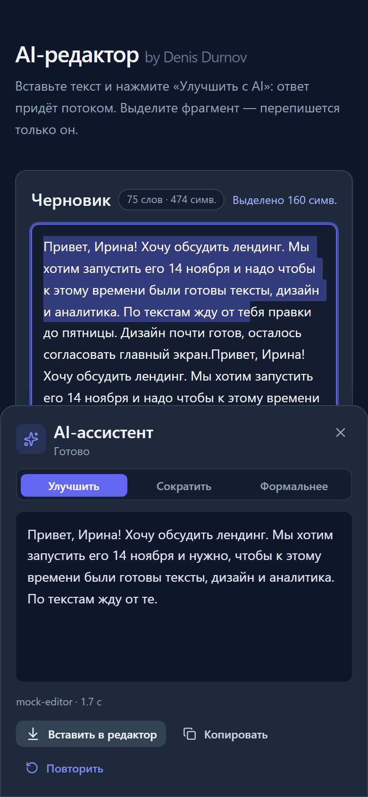
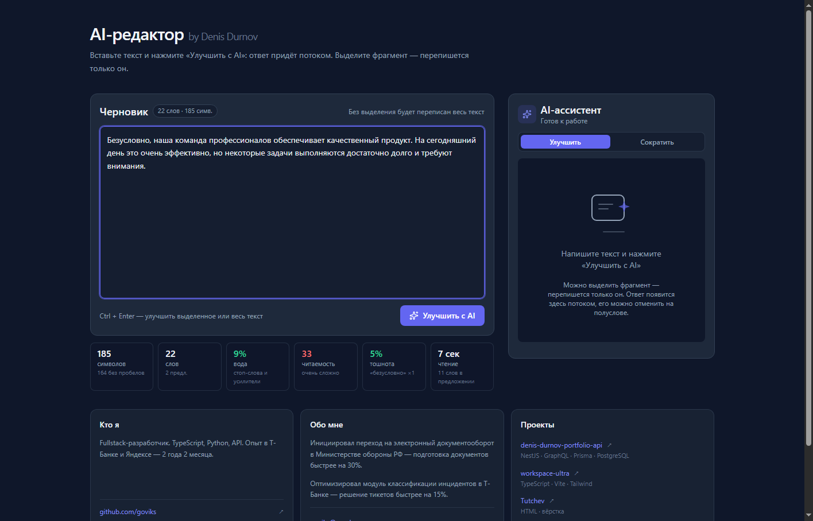

# AI-редактор

Текстовый редактор с AI-ассистентом: выделяете фрагмент или пишете с нуля — ассистент
переписывает текст по литературной норме, сокращает его и показывает метрики в реальном
времени: воду, читаемость, тошноту и оценку по шкале «Главреда».

**Демо:** https://ai-editor-assistant.vercel.app — работает без ключа, в демонстрационном
режиме.



## Возможности

- **Улучшить** — литературная правка: орфография, пунктуация, типографика, замена
  канцелярита и разговорных слов, удаление слов-сорняков. Результат доводится до
  метрик: вода ≤ 10%, тошнота ≤ 10%, читаемость > 70.
- **Сократить** — текст становится короче: убираются вода, штампы, повторы и
  второстепенные части, смысл сохраняется. Вода и тошнота доводятся до ≤ 5%.
- **Стриминг ответа** — текст появляется по словам, а не через 10 секунд ожидания.
- **Отмена** — запрос обрывается на полуслове, полученное сохраняется.
- **Понятные ошибки** — неверный ключ, лимит запросов, таймаут, пустой ответ: у каждой
  ошибки своё сообщение и подсказка.
- **Проверка орфографии и грамматики** — ошибки подсвечиваются прямо в тексте,
  есть переход по ним, фильтры по типам (орфография, пунктуация, грамматика, стиль),
  счётчик ошибок на 100 слов и кнопка «Применить безопасные».
- **Исправление в один клик** — любая найденная ошибка применяется одной кнопкой,
  без ручного поиска места в тексте.
- **Свой словарь** — слова, которые не нужно считать ошибками (термины, названия),
  добавляются в один клик и запоминаются в браузере.
- **Загрузка файлов** — перетащите `.txt`, `.md` или `.docx` в редактор или выберите
  файл кнопкой «Файл».
- **История версий** — каждое исправление и вставка сохраняются в истории,
  любую версию можно вернуть одним кликом.
- **Строгость проверки** — показывать все замечания или только ошибки (без стиля).
- **Метрики текста** — символы, слова, вода, читаемость, тошнота, время чтения, оценка
  «Главреда»; обновляются при каждом изменении текста.
- **Черновик сохраняется** — текст не теряется при обновлении страницы.
- **Горячие клавиши** — `Ctrl + Enter` запуск, `Esc` отмена.
- **Мобильная версия** — панель ассистента выезжает снизу.

## Как это выглядит

| Загрузка | Стриминг |
| --- | --- |
|  |  |

| Результат | Отмена |
| --- | --- |
|  |  |

| Мобильный вид | Метрики текста |
| --- | --- |
|  |  |

## Технологии

Next.js 15 (App Router) · React 19 · TypeScript · Tailwind CSS · Zustand · OpenAI API

## Запуск на Windows

Нужен Node.js 20 или новее.

```powershell
cd ai-editor-assistant
npm install
Copy-Item .env.local.example .env.local
npm run dev
```

Откройте http://localhost:3000

### Настройки

Файл `.env.local`:

```
OPENAI_API_KEY=sk-...   # ключ OpenAI
OPENAI_MODEL=gpt-4o-mini
AI_MOCK=1               # демо-режим без ключа
```

`AI_MOCK=1` включает демонстрационный режим: текст обрабатывается встроенными правилами,
ключ не нужен, запросы в интернет не уходят. Уберите эту строку и укажите ключ, чтобы
работала настоящая модель.

## Ограничения проверки

- Проверка текста — до 5000 знаков за один запрос.
- Не больше 20 проверок за 10 минут с одного адреса (настраивается переменной
  `CHECK_RATE_LIMIT`).
- Одинаковые тексты кешируются на 5 минут — повторная проверка не тратит лимит.
- Если внешний сервис проверки недоступен, включаются встроенные правила.

## Деплой на Vercel

1. Загрузите проект в GitHub.
2. Откройте [vercel.com/new](https://vercel.com/new) и выберите репозиторий.
3. В настройках проекта добавьте `OPENAI_API_KEY` (или `AI_MOCK=1` для демо).
4. Нажмите Deploy.

Каждый `git push` после этого собирается автоматически.

## Структура проекта

```
app/            страницы и API-маршрут ассистента
components/     интерфейс: редактор, панель ответа, метрики
lib/ai/         правила текста, работа с моделью, демо-режим
lib/store/      состояние редактора и ответа
types/          общие типы
docs/           скриншоты
```

## Контакты

Денис Дурнов — [github.com/goviks](https://github.com/goviks) ·
[goviks@yandex.ru](mailto:goviks@yandex.ru)

---

Все права сохранены — 2026
